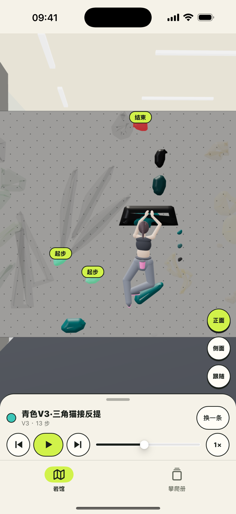
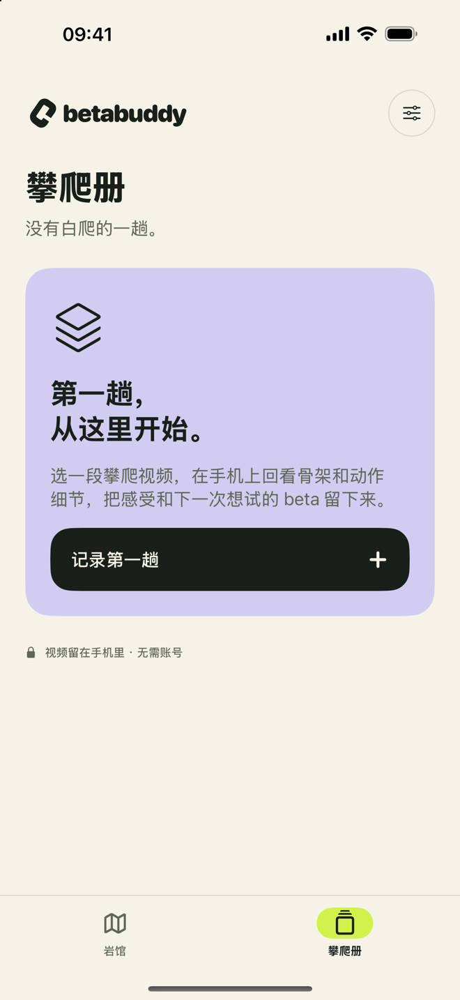

# BetaBuddy

「再试一次。这次，有点不一样。」

BetaBuddy 是一个手机应用，有 iPhone 版和 Android 版：在岩馆里看一条线换个身材可以怎么爬，再回看自己的攀岩视频，把每一趟记成手账。全部在手机上完成，不需要账号，也不联网。界面支持简体中文、繁体中文、英语、日语和韩语：默认跟随系统，也可以在应用内的设置里随时切换，立即生效。

<p align="center">
  
  &nbsp;&nbsp;&nbsp;
  
</p>

## 能做什么

两个入口，各管一件事；两个平台是同一个产品。

- **岩馆**：打开就在这里。岩馆的 3D 线路图，按岩壁和线路筛选，选一条线，换一个身材，看模型推演出的一种走法。
- **攀爬册**：自己的每一趟。可以在应用里直接拍：取景时由数据包里的拍摄页面在手机上检查机位、认出这面墙的岩点，录完先存进攀爬册再分析；选岩馆时可以按距离列出附近的馆。也可以导入视频，直接保存，时间优先读取视频拍摄时间，也可手动修改。回看是原片、逐帧步进和 0.5× 慢放，不叠骨架。「分析这一趟」从这段视频里认出墙上的岩点和你的动作，放进人体模型里比较，点某一步可以回到视频里的那一刻；这项分析来自场馆数据包里的分析页面，没有它的构建不显示入口。每一趟留下难度、岩馆、攀爬日期、是否完攀和一句下次想试的改变。用文件夹收纳，也可以叠加岩馆、难度、时间与完攀状态筛选。

## 三条原则

**本地。** 姿态模型和场馆数据都在安装包里。视频、分析结果和笔记只存在这台手机上，不上传，不进云备份。岩馆、拍摄和分析页面都被应用禁止访问网络；Android 版不申请联网权限。相机只在应用内拍摄时使用，不录声音；位置只在按距离找岩馆时取一次，用来给内置的岩馆目录排序，不保存。

**诚实。** 不给「稳定性 93 分」这类没验证过的评分。「分析这一趟」里的岩点、墙面和动作是从视频里自动认的，会有认错的地方；数字是在人体模型里比出来的相对值，不是教练建议。岩馆是非官方整理，可能与现场不符；推演是模型算出来的一种可能，不是教练建议。完整说明见[产品设计](docs/ios/product-design.md)和[岩馆设计](docs/ios/gym-design.md)。

**免费。** 攀爬册和岩馆的基本功能免费，没有广告、订阅、账号、排行榜和打卡压力。iOS 版有一项可选的一次性终生会员内购，解锁数据包里的更多岩馆和猫攀爬；购买与恢复由 App Store 处理，应用在设备上用 StoreKit 核对权益。

## 快速开始

### iOS

需要一台装了 Xcode（含 iOS SDK）的 Mac 和 [XcodeGen](https://github.com/yonaskolb/XcodeGen)。应用支持 iOS 17 及以上的 iPhone。

```sh
brew install xcodegen
./ios/scripts/bootstrap.sh     # 下载固定版本的 MediaPipe SDK 并校验，生成 Xcode 工程
open ios/BetaBuddy.xcodeproj
```

在 Xcode 里选 BetaBuddy scheme。跑模拟器直接 Run；跑真机先在 Signing & Capabilities 里选自己的开发团队。

命令行构建和测试：

```sh
swift test --package-path ios                       # 几何与时序的核心测试，在 Mac 上直接跑

xcodebuild -project ios/BetaBuddy.xcodeproj -scheme BetaBuddy \
  -destination 'platform=iOS Simulator,name=<已安装的模拟器>' test

xcodebuild -project ios/BetaBuddy.xcodeproj -scheme BetaBuddy \
  -destination 'generic/platform=iOS' CODE_SIGNING_ALLOWED=NO build
```

更多细节见 [ios/README.md](ios/README.md)。

### Android

需要 JDK 17 和 Android SDK（平台 37）。Gradle 用仓库里的 wrapper，不用另装。应用支持 Android 8.0（API 26）及以上。

```sh
export JAVA_HOME="$(brew --prefix openjdk@17)/libexec/openjdk.jdk/Contents/Home"
export ANDROID_HOME=<SDK 目录>                # 或在 android/local.properties 里写 sdk.dir=<SDK 目录>

cd android
./gradlew :app:assembleDebug                 # 产物在 app/build/outputs/apk/debug/
./gradlew :app:testDebugUnitTest             # JVM 上的单元测试
./gradlew :app:assembleRelease               # R8 + 资源压缩；没配 keystore 时用 debug 密钥签名
```

不装 SDK 也能跑的检查：`python3 android/scripts/check-resources.py`（资源、五种语言的文字、Manifest）。版本组合、签名、调试参数和验证状态见 [docs/android/README.md](docs/android/README.md)。

## 场馆数据包

攀爬册用于标记和筛选的**全国岩馆目录**与下述 3D 场馆数据包分开管理。目录是随应用提供的公开资料快照，可以离线搜索；未收录的岩馆可以手填。来源、覆盖范围与更新方法见 [岩馆目录说明](docs/gym-directory.md)。目录不代表实时营业状态，也不提供场馆模型或线路。

「岩馆」里的场馆模型、线路和推演来自一个单独生成的**场馆数据包**。它不在这个仓库里，也不应该被提交进来；仓库里只有加载它的原生壳和接口约定。

- **没有数据包**：工程照常生成、编译、测试。「岩馆」入口会说明这个构建没有内置岩馆数据，攀爬册不受影响。
- **有数据包**：先装进工程，再构建。

```sh
./ios/scripts/install-gym-pack.sh /path/to/GymPack   # 核对清单和每个文件的 SHA-256，拷到 ios/GymPack/
./ios/scripts/install-gym-pack.sh --remove           # 回到不含数据包的构建
```

Android 版同理，装到的是 `android/app/src/main/assets/gympack/`：

```sh
./android/scripts/install-gym-pack.sh /path/to/GymPack
./android/scripts/install-gym-pack.sh --remove
```

`ios/GymPack/` 和 `android/app/src/main/assets/gympack/` 都被 Git 忽略。数据包的目录结构、清单字段和页面与应用之间的消息，见[岩馆设计](docs/ios/gym-design.md)里的接口约定。

## 仓库结构

```
ios/
  BetaBuddy/            应用源码
    App/                应用入口、两个入口的导航、终生会员
    Core/               数据结构、几何、姿态推理、本地存储、数据包加载、应用内拍摄、按距离排序岩馆
    Views/              设计系统与各页面
    Resources/          图标、姿态模型、岩馆目录、五种语言的 String Catalog、隐私清单与政策、第三方许可
  BetaBuddyTests/       单元与集成测试（模拟器）
  BetaBuddyUITests/     界面冒烟测试与端到端测试
  CoreTests/            可在 Mac 上直接跑的核心测试
  TestSupport/          两个测试包共用的合成素材与替身页面
  StoreKit/             终生会员的本地 StoreKit 配置
  LocalMediaPipe/       把 SDK 的指标上报替换为空实现
  scripts/              bootstrap、数据包安装、图标生成、导出配置
  project.yml           XcodeGen 工程描述
android/
  app/src/main/java/com/betabuddy/android/
    MainActivity.kt     唯一的 Activity
    ui/                 设计系统、公共组件、两个入口与设置的导航
    gym/                数据包加载、WebView 容器、消息桥
    journal/ pose/ review/ data/   攀爬册：列表与导入、姿态识别、回看与分析、本地存储
    capture/            应用内拍摄、选岩馆
    settings/ i18n/     设置与关于、隐私政策、应用内语言
  app/src/main/res/     五种语言的文字、内置隐私政策、图标、备份规则
  app/src/main/assets/  姿态模型、岩馆目录、第三方许可
  app/src/test/         JVM 单元测试
  app/src/androidTest/  设备测试与替身页面
  gradle/               版本目录与 Gradle wrapper
  scripts/              数据包安装、资源检查
docs/ios/               设计、验证记录、发布资料
docs/android/           Android 工程说明与设计
docs/gym-directory.md   岩馆目录的来源、覆盖与更新方法
data/gym-directory/     岩馆目录的权威快照与坐标缓存
scripts/gym-directory/  岩馆目录的抓取、定位与检查脚本
services/               支持与隐私网页、交易核对 Worker（应用未调用）
legacy/web/             早期的网页实现，不再维护
```

## 文档

| 文档 | 内容 |
| --- | --- |
| [ios/README.md](ios/README.md) | 构建、测试、姿态模型与推理管线 |
| [docs/ios/product-design.md](docs/ios/product-design.md) | 产品性格、视觉、主任务流、分析诚实性、语言 |
| [docs/ios/gym-design.md](docs/ios/gym-design.md) | 岩馆入口的设计与数据包接口约定 |
| [docs/ios/validation.md](docs/ios/validation.md) | 做过哪些验证，哪些还没做 |
| [docs/gym-directory.md](docs/gym-directory.md) | 全国岩馆目录：来源、覆盖、坐标精度、更新方法 |
| [docs/ios/app-store/](docs/ios/app-store/STATUS.md) | 发布状态、发布流程、各版本的商店资料 |
| [docs/android/README.md](docs/android/README.md) | Android：构建、版本组合、目录、调试、验证状态 |
| [docs/android/design.md](docs/android/design.md) | Android：导航、岩馆容器、攀爬册、语言，与 iOS 的差异 |
| [docs/ios/brand/README.md](docs/ios/brand/README.md) | 品牌标志与图标生成 |
| [legacy/web/README.md](legacy/web/README.md) | 早期的网页实现 |

## 许可与第三方

源码以 MIT 许可发布。

应用使用 Google 的 MediaPipe Tasks SDK 和 Pose Landmarker Full 模型（Apache-2.0），权重未改动。岩馆目录里的坐标取自 OpenStreetMap（ODbL），不适用本项目的 MIT 许可。来源、版本和校验值见 [ios/THIRD_PARTY.md](ios/THIRD_PARTY.md) 和 [android/THIRD_PARTY.md](android/THIRD_PARTY.md)；许可全文随应用打包，Android 版在「设置与关于」里可以查看。场馆数据包不属于本仓库，不在这份许可之内。
