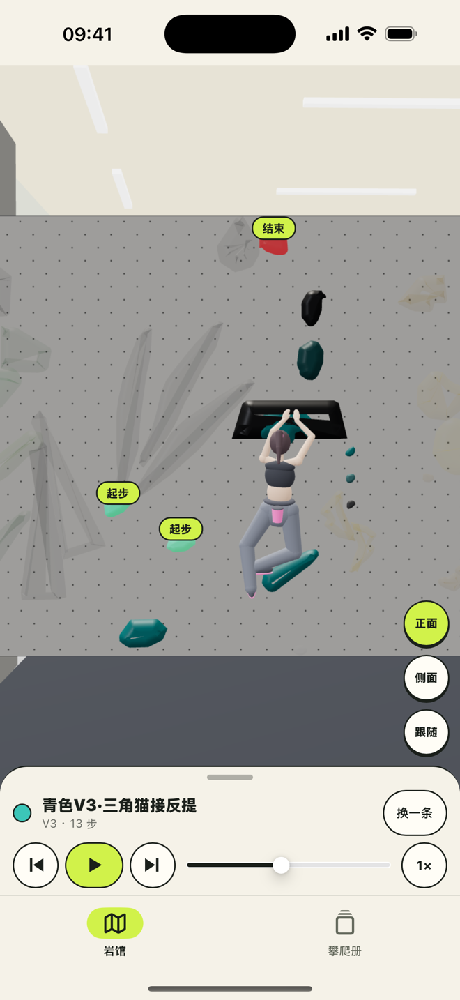
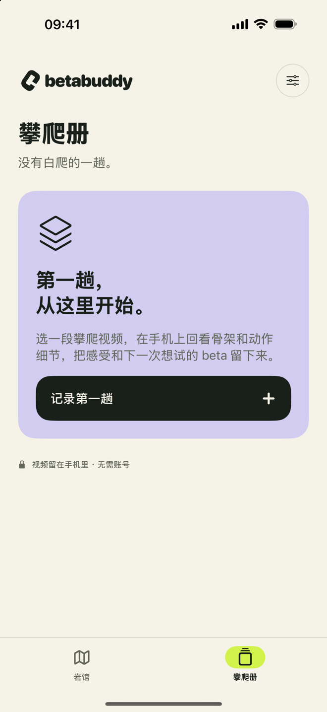

# BetaBuddy

「再试一次。这次，有点不一样。」

BetaBuddy 是一个 iPhone 应用：在岩馆里看一条线换个身材可以怎么爬，再回看自己的攀岩视频，把每一趟记成手账。全部在手机上完成，不需要账号，也不联网。界面支持简体中文、繁体中文、英语、日语和韩语：默认跟随系统，也可以在应用内的设置里随时切换，立即生效。

<p align="center">
  
  &nbsp;&nbsp;&nbsp;
  
</p>

## 能做什么

两个入口，各管一件事。

- **岩馆**：打开就在这里。一家岩馆的 3D 线路图，按岩壁和线路筛选，选一条线，换一个身材，看模型推演出的一种走法。
- **攀爬册**：自己的每一趟。导入一段攀爬视频，在手机上识别 33 个身体关键点；回看时可以切换原片和骨架、看髋部短轨迹、0.1 秒步进、0.5× 慢放，候选片段一点就到。每一趟留下难度、是否完攀、一句下次想试的改变，可以按完攀状态筛选，按名字或难度搜索。

## 三条原则

**本地。** 姿态模型和场馆数据都在安装包里。视频、分析结果和笔记只存在这台手机上，不上传，不进云备份。岩馆页面被应用禁止访问网络。

**诚实。** 不给「稳定性 93 分」这类没验证过的评分。髋部轨迹是画面里的几何位置，不叫重心；角度是二维投影角，不是关节的真实角度；高抬脚只算「候选片段」，要对着原片确认。岩馆是非官方整理，可能与现场不符；推演是模型算出来的一种可能，不是教练建议。完整说明见[产品设计](docs/ios/product-design.md)和[岩馆设计](docs/ios/gym-design.md)。

**免费。** 没有广告、内购、订阅、排行榜和打卡压力。

## 快速开始

需要一台装了 Xcode（含 iOS SDK）的 Mac 和 [XcodeGen](https://github.com/yonaskolb/XcodeGen)。应用支持 iOS 17 及以上的 iPhone。

```sh
brew install xcodegen
./ios/scripts/bootstrap.sh     # 下载固定版本的 MediaPipe SDK 并校验，生成 Xcode 工程
open ios/BetaBuddy.xcodeproj
```

在 Xcode 里选 BetaBuddy scheme。跑模拟器直接 Run；跑真机先在 Signing & Capabilities 里选自己的开发团队。

命令行构建和测试：

```sh
swift test --package-path ios                       # 几何与时序的核心测试，在 Mac 上直接跑

xcodebuild -project ios/BetaBuddy.xcodeproj -scheme BetaBuddy \
  -destination 'platform=iOS Simulator,name=<已安装的模拟器>' test

xcodebuild -project ios/BetaBuddy.xcodeproj -scheme BetaBuddy \
  -destination 'generic/platform=iOS' CODE_SIGNING_ALLOWED=NO build
```

更多细节见 [ios/README.md](ios/README.md)。

## 场馆数据包

「岩馆」里的场馆模型、线路和推演来自一个单独生成的**场馆数据包**。它不在这个仓库里，也不应该被提交进来；仓库里只有加载它的原生壳和接口约定。

- **没有数据包**：工程照常生成、编译、测试。「岩馆」入口会说明这个构建没有内置岩馆数据，攀爬册不受影响。
- **有数据包**：先装进工程，再构建。

```sh
./ios/scripts/install-gym-pack.sh /path/to/GymPack   # 核对清单和每个文件的 SHA-256，拷到 ios/GymPack/
./ios/scripts/install-gym-pack.sh --remove           # 回到不含数据包的构建
```

`ios/GymPack/` 被 Git 忽略。数据包的目录结构、清单字段和页面与应用之间的消息，见[岩馆设计](docs/ios/gym-design.md)里的接口约定。

## 仓库结构

```
ios/
  BetaBuddy/            应用源码
    App/                应用入口与两个入口的导航
    Core/               数据结构、几何、姿态推理、本地存储、数据包加载
    Views/              设计系统与各页面
    Resources/          图标、姿态模型、五种语言的 String Catalog、隐私清单与政策、第三方许可
  BetaBuddyTests/       单元与集成测试（模拟器）
  BetaBuddyUITests/     界面冒烟测试
  CoreTests/            可在 Mac 上直接跑的核心测试
  LocalMediaPipe/       把 SDK 的指标上报替换为空实现
  scripts/              bootstrap、数据包安装、图标生成、导出配置
  project.yml           XcodeGen 工程描述
docs/ios/               设计、验证记录、发布资料
legacy/web/             早期的网页实现，不再维护
```

## 文档

| 文档 | 内容 |
| --- | --- |
| [ios/README.md](ios/README.md) | 构建、测试、姿态模型与推理管线 |
| [docs/ios/product-design.md](docs/ios/product-design.md) | 产品性格、视觉、主任务流、分析诚实性、语言 |
| [docs/ios/gym-design.md](docs/ios/gym-design.md) | 岩馆入口的设计与数据包接口约定 |
| [docs/ios/validation.md](docs/ios/validation.md) | 做过哪些验证，哪些还没做 |
| [docs/ios/app-store/](docs/ios/app-store/STATUS.md) | 发布状态、发布流程、各版本的商店资料 |
| [docs/ios/brand/README.md](docs/ios/brand/README.md) | 品牌标志与图标生成 |
| [legacy/web/README.md](legacy/web/README.md) | 早期的网页实现 |

## 许可与第三方

源码以 MIT 许可发布。

应用使用 Google 的 MediaPipe Tasks SDK 和 Pose Landmarker Full 模型（Apache-2.0），权重未改动。来源、版本和校验值见 [ios/THIRD_PARTY.md](ios/THIRD_PARTY.md)，许可全文随应用打包。场馆数据包不属于本仓库，不在这份许可之内。
